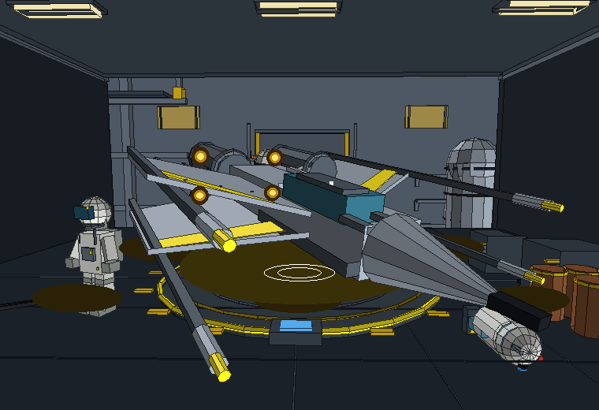
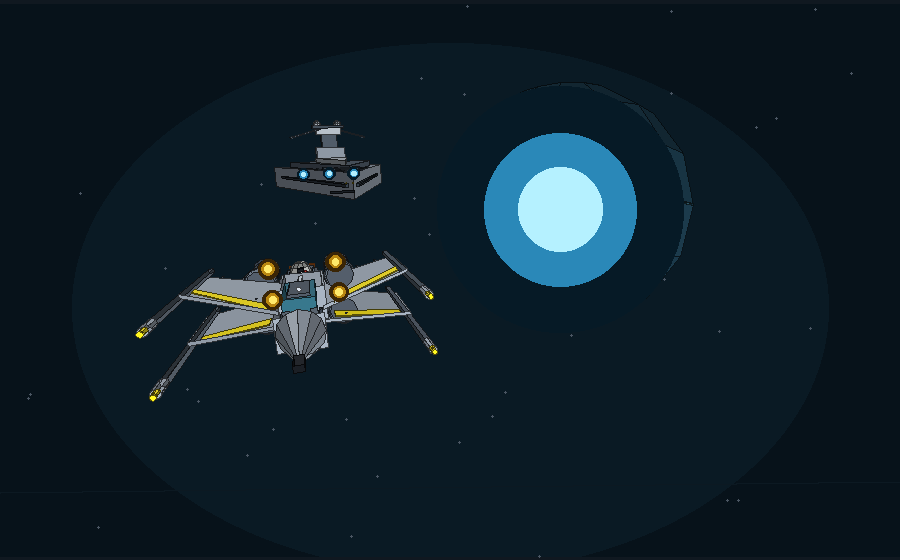
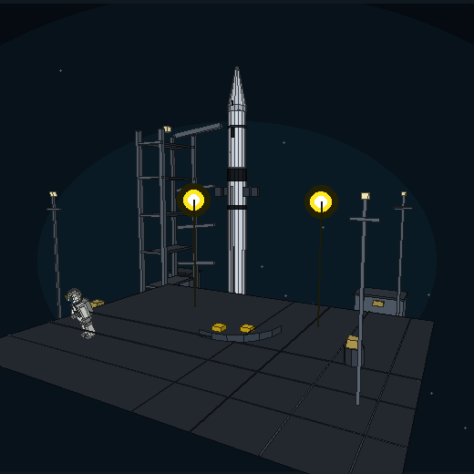
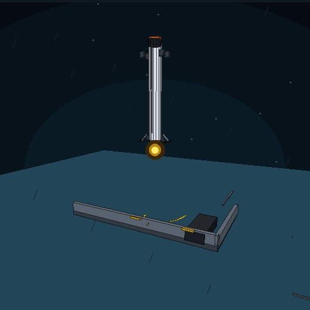
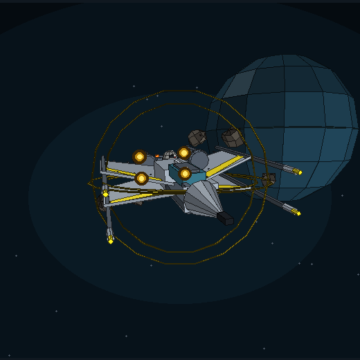
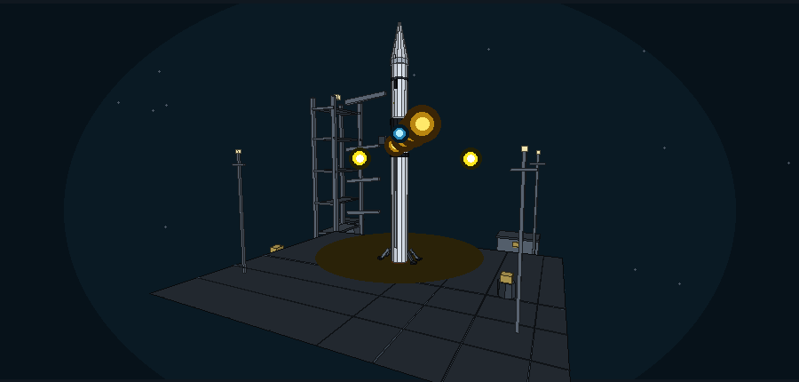
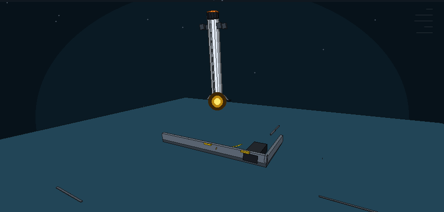
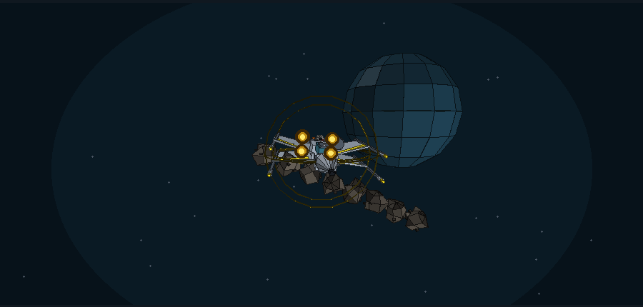

# The Interstellar Driver's Ed

**Rebel-SpaceX Flight Simulator** — a complete desktop game in Python/Tkinter with a real-time software 3D engine, procedural audio, an interactive five-ship hangar and three playable missions.

No image assets, no runtime downloads, no network. The release ships as a Windows executable and a macOS app, with the source and a local archive site in the same repository.

## What is new in v1.2.0

- **Real 3D everywhere in the game.** A dependency-free software renderer (`engine3d.py`) draws lit, depth-sorted polygon meshes on Tk Canvas. The X-wing, TIE, Star Destroyer, Falcon 9, Starship, booster, drone ship, launch pad, hangar, planets, asteroids and crew are hand-built meshes in `fleet3d.py`.
- **The hangar is fixed and interactive.** Drag to orbit, mouse wheel to zoom, `A` to pause auto-orbit, `R` to reset. The static bay is cached, the old reference-card overlay no longer blocks dragging, and every ship has its own camera and dossier.
- **Five ships in the bay:** X-wing, TIE fighter, Imperial Star Destroyer, Falcon 9 and Starship.
- **Procedural audio.** `audio.py` synthesises the click, confirm, deny, servo, impact, success, warning, shield, engine and ambient WAVs with pygame at runtime. If no audio device is available the game falls back to silence.
- **Characters that help.** Major Vega and R2-D2 give live CAPCOM calls in flight, while K-3PO briefs each mission and Major Vega tutors in the hangar. The hangar exam still uses the original twenty-question SpaceX paper.
- **The .exe is back.** The GitHub Actions workflow builds `InterstellarDriversEd-Windows.zip` (folder + `InterstellarDriversEd.exe`) and `InterstellarDriversEd-macOS.zip`.

## Quickstart

From a checkout:

```bash
python -m pip install -r requirements.txt
python simulator.py
```

Python 3.8+ with Tkinter is required. `requirements.txt` pins CustomTkinter 5.2.2 and pygame 2.6.1. On a machine without an audio device the game still runs silently.

Prebuilt downloads: [latest release](https://github.com/Jaskirat025/interstellar-drivers-ed/releases/latest).

- **Windows:** unzip `InterstellarDriversEd-Windows.zip`, then run `InterstellarDriversEd.exe` inside the folder.
- **macOS:** unzip `InterstellarDriversEd-macOS.zip`, then move `InterstellarDriversEd.app` to Applications.

Both bundles are unsigned. On Windows SmartScreen choose **More info → Run anyway**; on macOS right-click the app, choose **Open**, then confirm.

## The three missions

| Mission | What you fly | What you learn |
| --- | --- | --- |
| 01 · Propellant load | Falcon 9 stack on Pad 39-A | Methane/oxygen load, a 2% Tibanna additive, a moving mixture band and injector strain |
| 02 · Hoverslam | Booster over a drone ship | One-engine landing burn, gravity, wind, RCS translation, fuel and a narrow deck |
| 03 · Debris run | X-wing through a wreck field | Shield choice, steering, hull pips, close calls and a twenty-second run |

Every mission has a decision score plus a flight bonus of up to **+30**. The run ceiling is **390 points**. Rank thresholds: Ground Crew, Flight Cadet, Senior Pilot, Squadron Leader, Jedi Ace.

## Controls

| Action | Input |
| --- | --- |
| Select a mission decision | `1` / `2` / `3` or click |
| Trim mixture | `↑` / `↓`, `W` / `S` |
| Landing burn | `Space` or `↑` |
| Steer / RCS | `←` / `→`, `A` / `D` |
| Pause / resume | `P` or `Esc` |
| Slow motion | `M` |
| Hangar orbit / zoom | Drag / mouse wheel |
| Hangar auto-orbit / reset | `A` / `R` |
| Answer an exam question | `1` / `2` / `3` or click |
| Fullscreen | `F11` |
| Sound on/off | Click `SOUND · ON` in the footer |
| Jump straight to a mission | Title → `PRESENTATION · JUMP TO MISSION` |

## Hangar

The hangar is a live 3D scene, not a static illustration:

- The bay is rendered once per camera/ship and cached; the ship is re-rendered as you orbit.
- Drag changes yaw and pitch with clamped limits; the wheel zooms between 0.55× and 2.4×.
- Auto-orbit pauses while dragging and resumes after two seconds.
- The ship dossier, instructor strip and exam reference are outside the viewer, so they never intercept a drag.
- The exam reference is a separate shaded 3D view of the model in the question.
- The cadet exam is session-only and never changes the mission score.

## 3D scene frames

These are frames painted headlessly by the same `visuals3d` painters the app uses. They show the polygon scenes, not mockups.

| Scene | Frame |
| --- | --- |
| Hangar bay with X-wing, astronaut and astromech |  |
| Title: X-wing, Star Destroyer and planet |  |
| Mission 01: Falcon 9 on the pad |  |
| Mission 02: booster and drone ship |  |
| Mission 03: X-wing, shield and debris |  |
| Load trim scene |  |
| Landing scene |  |
| Debris field |  |

The archive landing page (`index.html`) is still included as a separate companion site. It is not required to play the game and the game is not embedded in it.

## Architecture

```text
simulator.py       Tk app, screens, missions, scoring and input
engine3d.py        software 3D engine: meshes, camera, clipping, shading, fog
fleet3d.py         hand-built ships, hangar, pad, drone ship, planets, crew
visuals3d.py       scene cameras, lighting pools, glows and Canvas painters
audio.py           procedural WAV synthesis and pygame playback with fallback
shipyard.py        original hangar meshes/projector; exam models and questions
visuals.py         shared palette and HUD primitives
dataviz.py         chart-ready telemetry
tests/             headless core, chart, vector and 3D tests
```

The 3D pipeline is intentionally small and readable: `Mesh` stores vertices and material-tagged faces; `Part` applies scale/rotation/translation; `Camera` projects perspective with near-plane clipping; `render` shades with key/fill/rim lights and fog, depth-sorts, and returns flat polygons for Tk Canvas. It never imports Tk, so the geometry and all scenes are testable headlessly.

## Tests

```bash
python -m unittest discover -s tests -v
```

The suite covers callsign validation, the 390-point ceiling, ranks, mission scoring, corrupt local JSON, chart metrics, the original shipyard models and exam, plus the new 3D engine, fleet meshes and every scene painter. Tests need no display and no audio device.

## Build the desktop apps

The workflow in `.github/workflows/build.yml` runs the tests, then PyInstaller on Windows and macOS. Both builds include `--collect-all customtkinter` and `--collect-all pygame`; macOS also stamps the bundle version.

```bash
pyinstaller --noconfirm --clean --onedir --windowed --noupx \
  --collect-all customtkinter --collect-all pygame \
  --name InterstellarDriversEd \
  --version-file packaging/version_info.txt simulator.py
```

On macOS use the same flags but `--windowed --osx-bundle-identifier com.rebelaerospace.interstellardriversed` and package `dist/InterstellarDriversEd.app` with `ditto`.

## Privacy

- The only file the game writes is `~/.interstellar_drivers_ed/pilot.json`: best score, best rank, callsign, flight count and the sound preference.
- Auth0 and Tiger Data are clearly labelled simulations. No account is created, no token is sent and no network request is made.
- No secrets, analytics or telemetry are embedded.
- Delete `~/.interstellar_drivers_ed` to reset the record.

## Credits

Built for MLH Hack Week. Spacecraft geometry and code are original; Star Wars names are used as a fan framing, not as official assets. NASA imagery in the companion archive is public domain and credited in `assets/photos/README.md`.

MIT license. See [LICENSE](LICENSE).
