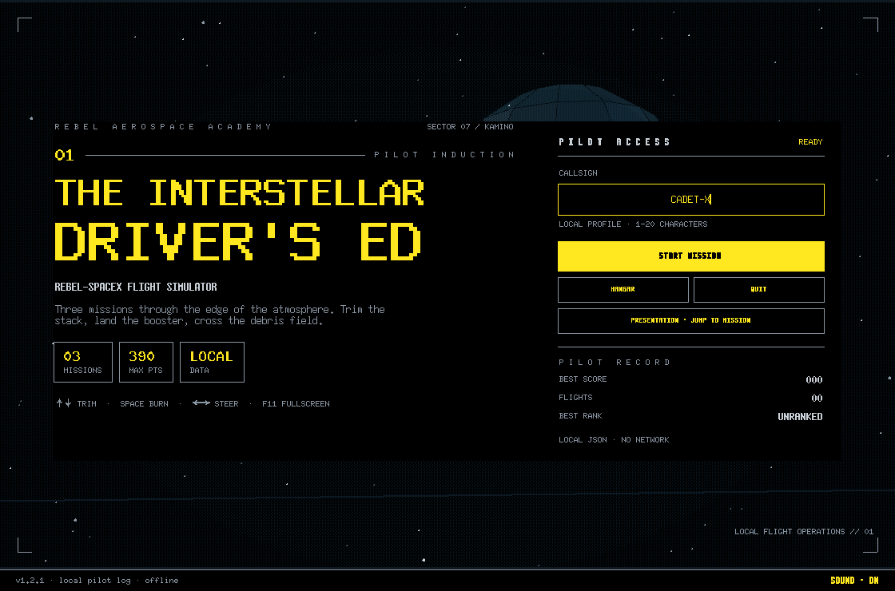

# Rebel Aerospace Archive & Flight Simulator

**The Interstellar Driver's Ed** is two deliberately separate things: a cinematic visual archive (`index.html`) and a playable desktop flight simulator (`simulator.py`). The site documents real SpaceX hardware through a Star Wars lens; the game is a small Tkinter desktop app that lives outside the page. No game is embedded in the archive.

The archive ships eight NASA photographs, two silent public-domain films, a canvas starfield and a scroll-driven flight profile. The app uses Tkinter plus CustomTkinter for its square desktop chrome, instrument-panel vector art and a small pilot record kept on the local machine. Auth0 and Tiger Data in the simulator are clearly labelled simulations; nothing is sent anywhere.

## Judge quickstart

No API keys, accounts, tenants or network are required. From the repository root:

```bash
python -m pip install -r requirements.txt
python simulator.py
```

Use `python3` if that is your launcher. The [three-minute judge route](docs/DEMO.md) covers every screen, the controls and the code highlights. For live judging, **PRESENTATION · JUMP TO MISSION** on the title screen skips straight to a chosen mission without touching the local record. There is also a copy-paste [MLH submission one-pager](docs/SUBMISSION.md). An animated tour:



## MLH Hack Week

This project was built during MLH Hack Week as a complete desktop game rather than a click-through prototype.

- **Track:** desktop and games.
- **Playable first:** every mission has a real control loop, a countdown, a HUD, pause and a written debrief.
- **Sponsor integrations:** Auth0 and Tiger Data are represented by local simulations, so the demo runs offline on any judge's laptop without API keys or tenants.
- **Judge-friendly:** install `requirements.txt` once and run `python simulator.py`; everything the game records stays local, and the release zips are built by GitHub Actions on Windows and macOS.
- **Three-minute demo:** [follow the judge route](docs/DEMO.md): title and callsign, simulated Auth0 sign-in, a propellant trim, a hoverslam, a debris run with slow motion, then the flight log and simulated hypertable save.

### Why the simulations

A judge should never need a live tenant or an API key to see the flow. The Auth0 sequence keeps the real choreography (progress, scopes, token) but generates the token locally. The Tiger Data save keeps the real vocabulary (hypertable, chunks, coordinate rows) but counts rows in memory. Both screens say SIMULATION on screen, and the source is short enough to read during judging.

## Features

- Native desktop window, resizable from 900 × 600, centred on launch and manually styled in black, Star Wars yellow and cool grey.
- Square, flat CustomTkinter controls for buttons, callsign entry and progress bars; the flight view and charts stay on native Tk Canvas for deterministic drawing.
- A visual flight-software shell across every screen: vector starfields, orbital diagrams, registration marks, mission-plan cards, a rank certificate and a live cockpit HUD. All art is drawn locally, with no image assets or runtime downloads.
- Animated title starfield, callsign validation, default `CADET-X`, and a local pilot record on the title screen.
- Simulated Auth0 sequence with a timed progress bar, local claim checks and a fake token generated with `hashlib`.
- Three missions, each with three scored decisions that set the difficulty of the flight that follows.
- **Mission 01 — load trim:** keep a moving mixture inside its tolerance band; injector strain can abort the pad.
- **Mission 02 — hoverslam:** one engine, limited fuel, wind and RCS translation over a pitching deck. Touch down below 9.5 m/s and inside the target.
- **Mission 03 — debris run:** steer a top-down X-wing through twenty seconds of wreckage; hull, close calls and difficulty depend on the shield decision.
- Performance bonus up to **+30 per mission**, added to the decision score; maximum run score is **390**.
- Native Canvas debrief charts for stability/load, touchdown speed/miss/fuel, hull/close calls and per-mission score; no chart library, web view or remote data.
- Instrument readouts for the briefing and final log, including difficulty, decision caps, flight bonus, rank badge and a three-column scoring ledger.
- Pause menu, restart, abort to title, fullscreen (`F11`) and in-app error panel instead of a traceback.
- Cinematic slow motion in flight: `M` toggles a 0.35× simulation scale with scanlines, vignette and a HUD badge. Physics, mission outcomes and the 390-point ceiling are unchanged.
- **Presentation mode:** from the title, jump straight to mission 01, 02 or 03, with a visible demo badge and no pilot-record writeback.
- Local pilot record: best score, best rank, last callsign and completed flights, saved as one JSON file.
- **Hangar:** three hand-built 3D meshes (X-wing, TIE fighter, Star Destroyer) rotated, shaded and projected in pure Python; drag to orbit, read the ship dossier, then take a twenty-question SpaceX cadet exam that stays separate from the mission score. Each question swaps in its own rotating 3D reference model, from a Falcon 9 and the chopstick tower to the drone ship, a heat-tile section and the X-wing.
- Simulated Tiger Data Hypertable Cloud save: progress bar and a counter of millions of coordinate rows written.
- All `after()` callbacks are cancelled on screen changes and on close.

## Visual archive and landing page

The landing page (`index.html`) is a self-contained companion site, intentionally separate from the game. It ships no remote fonts, scripts, hotlinked images, or embedded game and works from a local static server. The simulator is linked from the page but never runs inside it.

- **Eight NASA photographs** in `assets/photos/`: Falcon 9/Crew-9 rollout, Falcon 9 landing after Crew-12, Crew-13 Dragon, Crew-11 approach, the Cupola sunset, Crew-9 liftoff, Falcon 9 landing after Crew-13, and the Demo-1 splashdown. They are resized and toned to the black/grey site palette. The originals are NASA public-domain imagery and are not presented as Star Wars or SpaceX mission assets.
- **Two local silent films** in `assets/video/`: a 16-second Crew-5 liftoff and a 24-second Crew-4 splashdown, trimmed from NASA coverage, desaturated, stripped of audio and encoded as H.264. Posters are local frames. Nothing is hotlinked and no YouTube iframe is used.
- **Coded motion:** a canvas starfield drifts with scroll and pointer movement, an SVG orbital plot moves at a slow cruise, the flight-profile meter fills as the sequence scrolls, and hovering a frame gives a restrained zoom. Section content is visible by default: there are no scroll reveals, counters, tickers or pointer tilt. The hero has a single short entrance, and all motion is reduced or paused for `prefers-reduced-motion`.
- **Photo lightbox:** each frame opens a native `<dialog>` viewer with title, credit, and keyboard/Escape support. Without JavaScript, the same links open the full JPEG directly.
- **Separate simulator door:** a single `#simulator` panel links to the release and source. It does not embed the Tkinter app, a canvas game or a fake login.

Credits: NASA/Keegan Barber (NHQ202409270003, NHQ202409280010), NASA/John Kraus (NHQ20260213_admin_0009, NHQ20261001_admin_0012), NASA (iss075e0157531, iss073e0422191, iss071e581260_alt), NASA/Cory Huston (KSC-20190308-PH_CSH01_0190), NASA Crew-5 highlights and Crew-4 splashdown footage. NASA does not endorse this project. Source: [NASA Image and Video Library](https://images.nasa.gov/). Full media notes: `assets/photos/README.md` and `assets/video/README.md`.

## Controls

| Action | Keys |
| --- | --- |
| Select a mission decision | `1`, `2`, `3` or click |
| Trim mixture / fire landing engine | `↑` / `↓`, `W` / `S`, `Space` |
| Steer the X-wing / RCS | `←` / `→`, `A` / `D` |
| Pause / resume | `P` or `Esc` |
| Slow motion in flight | `M` toggles 0.35× |
| Jump to a mission for a demo | Title → `PRESENTATION · JUMP TO MISSION` |
| Orbit the hangar model | Drag |
| Answer a cadet exam question | `1`, `2`, `3` or click |
| Fullscreen | `F11` |

## Scoring and ranks

Each mission adds the option score plus a flight performance bonus capped at 30. The best possible run is 390 points.

| Score | Rank |
| --- | --- |
| 350–390 | Jedi Ace |
| 270–349 | Squadron Leader |
| 190–269 | Senior Pilot |
| 100–189 | Flight Cadet |
| below 100 | Ground Crew |

## SpaceX in the simulator

| SpaceX engineering | In the game |
| --- | --- |
| Falcon 9 flies on RP-1 and liquid oxygen; Starship moves to subcooled methane and oxygen | Mission 01: load methane, oxygen and a fictional Tibanna additive |
| Raptor's full-flow staged combustion and tight propellant margins | Mission 01 mechanics: mixture band, injector strain, load rate |
| Drone-ship landings, grid fins and the hoverslam | Mission 02: flight model with gravity, thrust, fuel, wind and RCS |
| Reusability and thermal protection (PICA-X, Starship tiles) | Mission 03: leading-edge Beskar versus full plating vs no shields |

Tibanna comes from Bespin, Beskar from Mandalore, and Kamino is a water world, which is exactly where a drone ship makes sense. The game never presents Tibanna or Beskar as real technology.

## Screenshots

Screens captured from the running app at 1120 × 760:

| Screen | File |
| --- | --- |
| Title and pilot record | [01-title.png](docs/screenshots/01-title.png) |
| Simulated Auth0 login | [02-auth.png](docs/screenshots/02-auth.png) |
| Mission 01, load trim | [03-load-trim.png](docs/screenshots/03-load-trim.png) |
| Mission 02, hoverslam | [04-hoverslam.png](docs/screenshots/04-hoverslam.png) |
| Mission 03, debris run | [05-debris-run.png](docs/screenshots/05-debris-run.png) |
| Debrief | [06-debrief.png](docs/screenshots/06-debrief.png) |
| Final score and simulated save | [07-flight-log.png](docs/screenshots/07-flight-log.png) |
| Hangar, 3D ships and cadet exam | [08-hangar.png](docs/screenshots/08-hangar.png) |
| Slow motion in flight | [10-slow-motion.png](docs/screenshots/10-slow-motion.png) |
| Presentation mission picker | [11-presentation.png](docs/screenshots/11-presentation.png) |

All twenty exam reference models in one gallery: [09-exam-models.png](docs/screenshots/09-exam-models.png).

## Requirements

- Python 3.8 or newer.
- Tkinter, which ships with the official Python installers for Windows and macOS.
- [CustomTkinter](https://customtkinter.tomschimansky.com/) 5.2.2 for the desktop chrome, pinned in `requirements.txt`.
- No network connection is used at runtime.

## Run from source

From the repository root, install the UI dependency once:

```bash
python -m pip install -r requirements.txt
python simulator.py
```

On some systems the launcher is `python3`:

```bash
python3 -m pip install -r requirements.txt
python3 simulator.py
```

## Downloads

Prebuilt v1.1.0 bundles are attached to the latest GitHub Release.

- **Windows:** [InterstellarDriversEd-Windows.zip](https://github.com/Jaskirat025/interstellar-drivers-ed/releases/latest/download/InterstellarDriversEd-Windows.zip) — unzip and run `InterstellarDriversEd.exe` inside the folder.
- **macOS:** [InterstellarDriversEd-macOS.zip](https://github.com/Jaskirat025/interstellar-drivers-ed/releases/latest/download/InterstellarDriversEd-macOS.zip) — unzip and move `InterstellarDriversEd.app` to Applications.

The archive's simulator section links to the latest release; the page does not embed the game.

## Test

Core tests need no display; the chart-data and vector-art tests need neither a display nor Tkinter:

```bash
python -m unittest discover -s tests -v
```

They cover callsign validation, the 390-point score ceiling, rank thresholds, mission difficulty ranks, debrief text, the local pilot record (including corrupt JSON), the chart-ready telemetry and score metrics, and the hangar meshes (valid vertices/faces, projection and shading, exam answers). The chart-data, vector-art and shipyard tests need no Tkinter at all:

```bash
python -m unittest tests.test_dataviz tests.test_visuals tests.test_shipyard -v
```

## Build the desktop apps

The workflow in `.github/workflows/build.yml` installs `requirements.txt`, runs the tests, then builds both platforms with PyInstaller and its `--collect-all customtkinter` hook. Windows receives a version-info resource; macOS receives a bundle identifier.

Windows (folder build, no console window, no UPX):

```bash
pyinstaller --noconfirm --clean --onedir --windowed --noupx --collect-all customtkinter --name InterstellarDriversEd --version-file packaging/version_info.txt simulator.py
```

macOS (app bundle, no console window, no UPX):

```bash
pyinstaller --noconfirm --clean --windowed --noupx --collect-all customtkinter --name InterstellarDriversEd --osx-bundle-identifier com.rebelaerospace.interstellardriversed simulator.py
```

Trigger the workflow manually from **Actions → Build desktop apps → Run workflow**, or push a tag such as `v1.1.0`. Tag builds also attach both zips to the GitHub Release.

## Security and privacy

- Both bundles are **unsigned**. Windows SmartScreen may show "Windows protected your PC": choose **More info**, then **Run anyway**. macOS Gatekeeper may refuse the first launch: right-click the `.app`, choose **Open**, then confirm **Open**.
- The only file the app writes is `~/.interstellar_drivers_ed/pilot.json` (best score, rank, callsign, flight count). Delete that folder to reset the record.
- Auth0 and Tiger Data are **simulated**. The login animation, the token and the hypertable write happen in memory; the app opens no network connections, starts no subprocesses and uploads nothing.
- The desktop app imports only the Python standard library, the local `dataviz`, `visuals` and `shipyard` helpers and CustomTkinter. None of them opens a network connection.

## Tech stack

- Python 3.8+ and Tkinter (Canvas, Frame, Label, Entry; no ttk themes), plus CustomTkinter 5.2 for the square chrome.
- Flat vector art drawn directly on Tk Canvas for the starfield, orbital diagrams, badge, cockpit HUD and charts; no image or charting dependency.
- A dependency-free software 3D pipeline in `shipyard.py`: vertex/face meshes, yaw/pitch rotation, flat shading and a painter's-algorithm depth sort onto Tk Canvas.
- HTML, inline CSS and vanilla JavaScript for the landing page: a canvas starfield, a scroll-linked flight profile, a native photo dialog and a local Auth0 demo message. No external assets.
- GitHub Actions with PyInstaller for Windows and macOS builds.

## Repository layout

```text
simulator.py                     Desktop application (game and screens)
shipyard.py                      Hand-built 3D ship meshes, projector and exam data
dataviz.py                       Chart-ready telemetry and score helpers
visuals.py                       Canvas vector art and HUD primitives
requirements.txt                 CustomTkinter UI dependency
index.html                       Self-contained landing page
docs/DEMO.md                     Three-minute judge route and pitch
docs/SUBMISSION.md               Copy-paste MLH Hack Week submission
docs/demo.gif                    Animated six-screen product tour
docs/screenshots/                Real UI captures and 20-model gallery
tests/test_core.py               Core unit tests, no display required
tests/test_dataviz.py            Chart metric tests, no Tkinter required
tests/test_visuals.py            Vector drawing smoke tests, no Tkinter required
tests/test_shipyard.py           3D mesh, projection and exam tests, no Tkinter required
packaging/version_info.txt       Windows version resource for PyInstaller
README.md                        This document
LICENSE                          MIT license
.gitignore                       Python and build ignores
.github/workflows/build.yml      Tests plus Windows and macOS build workflow
```

## License

MIT. See [LICENSE](LICENSE).
